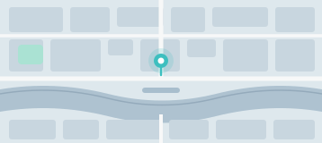

# Enigma X Auth — components.md

Copy-paste HTML for every component of the Enigma X auth system (web sign-in + mobile authenticator), the intended JS behaviour, the icon recipe, the Extended table and the dependency notes.

- Source of truth: `hub/auth/enigma-signin.html` (**W**) and `hub/auth/enigma-authenticator.html` (**A**), harvested into `enigma-x/auth-html-spec/*.md`. Rules: `audit/BUILD_RULES.md` section 11 (document, don't reproduce source bugs).
- Files: `tokens.css` (`--eauth-*`), `components.css` (`.web-*`, `.app-*`, `.eauth-icon`), `assets/`, `showcase.html` (live reference of every snippet below, each with a Copy HTML button).
- Light only. Fonts DM Sans + DM Mono (Google Fonts link below). The markup below is the exact markup the showcase renders.

## 0. Setup

```html
<link rel="preconnect" href="https://fonts.googleapis.com">
<link rel="preconnect" href="https://fonts.gstatic.com" crossorigin>
<link href="https://fonts.googleapis.com/css2?family=DM+Sans:wght@400;500;600;700&family=DM+Mono:wght@500;600&display=swap" rel="stylesheet">
<link rel="stylesheet" href="tokens.css">
<link rel="stylesheet" href="components.css">
```

- Web page: `<body class="web-page">` (min-height 100vh, centred, `#EBEBEB`) containing one `.web-card`. Inside a frame use `web-page web-page--contained` (EXTENDED, drops the min-height).
- Mobile page: `<body class="app-stage">` containing one `.app-shell` (390x844, not scaled). Inside a frame use `app-stage app-stage--contained` (EXTENDED).
- Reset: components.css ships a zero-specificity scoped reset (`box-sizing:border-box; margin:0; padding:0`) for `.web-page`, `.web-card`, `.app-stage`, `.app-shell` and their descendants. Do not add a global reset that changes component margins.
- The app shell uses `min(390px,100vw) x min(844px,100dvh)`: give it a viewport of at least 844px tall (or override `height` in a frame).

### State hooks (forced classes + JS state classes)

Real pseudo-classes work (`:hover :focus :active :disabled :checked`). Forced classes exist so a state can be displayed or driven by JS: `.is-hover .is-focus .is-active .is-disabled`. The prototypes' JS state classes were renamed:

| prototype class | this system |
|---|---|
| `.active` (view) | `.is-active` on `.web-view` |
| `.error`, `.has-error` | `.is-error` (input, OTP slot) |
| `.filled` | `.is-filled` (OTP slot) |
| `.loading` | `.is-loading` (+ `disabled`) |
| `.checked` | `:checked` on the real input (or `.is-checked` on `.web-checkbox`) |
| `.warn` / `.urgent` | `.is-warn` (web timer) / `.is-urgent` (app countdown) |
| `.show` | `.is-show` (field error, OTP error, push, overlay, dialog, toast, empty state, `.app-sessions-empty`) |
| `.open` | `.is-open` (`.app-sheet`) |
| `.hidden` | `.is-hidden` (`.app-launch`, `.app-faceid`) |
| `.status-bar--teal` | `.app-status-bar.is-chrome` |
| new hooks | `.is-pressed` (password toggle), `.is-copied` (copy button), `.is-fading` (code card), `.is-removing` (session row), `.is-entering` (London card), `.is-current / .is-before / .is-after` (screen position) |

## 1. Icons (mask recipe)

Monochrome icons are CSS masks of the exported SVG files, coloured by `currentColor`. Never redraw or hand-write icon paths.

```html
<span class="eauth-icon eauth-i-clock" aria-hidden="true"></span>
```

```css
.eauth-icon { display:block; flex-shrink:0; background-color:currentColor;
  -webkit-mask: center / contain no-repeat; mask: center / contain no-repeat; }  /* mask-image per .eauth-i-NAME */
.eauth-i-clock { -webkit-mask-image:url(assets/web-icon-clock.svg); mask-image:url(assets/web-icon-clock.svg); }
```

The component sets the size (`width/height`) and the colour. Classes: `.eauth-i-logo` (one class for every Enigma mark: web 72px `#7AEFEF`, launch 108px `#3DBFBF`, home tile 30px and push tile 22px white), `-eye-show -eye-hide -check-checkbox -clock -arrow-left -check-success` (web), `-wifi -battery -back-arrow -eye -copy -check-confirmed` (app). Sizes/colours: see `showcase.html` > Icons & logos and `assets/MANIFEST-web.md`, `MANIFEST-app.md`. The map `assets/app-map-london.svg` is an `` (illustration). No eye-off icon exists in the app (the web has `web-icon-eye-hide.svg`), no close icon, no icon set beyond these.

---

# PART A — WEB SIGN-IN (`.web-*`)

## A1. Page backdrop + card

Source: W L36-42, L45-52 (page), L79-87 (card). Card: width 100%, max 440px, `#FFFFFF`, radius 8px, padding `0 40px 36px` (content 360), shadow `0 4px 24px rgba(0,0,0,.08), 0 2px 4px rgba(0,0,0,.04)`, top padding 0 (the logo header supplies it). `@media (max-width:500px)`: padding `0 24px 28px` (the only media query). Success view: `.web-card--success` (padding 32px, no logo header).

```html
<body class="web-page">
  <div class="web-card">
    <div class="web-card-logo"><span class="eauth-icon eauth-i-logo web-logo" aria-hidden="true"></span></div>
    <div class="web-view is-active" id="view-login">
      <h1 class="web-title">Welcome back to Enigma X</h1>
      <p class="web-sub">Sign in to access your trading dashboard.</p>
      <div class="web-field">
        <label class="web-field-label" for="email">EMAIL ADDRESS</label>
        <div class="web-field-wrap">
          <input class="web-input" id="email" type="email" placeholder="you@enigma.io" autocomplete="email" autocapitalize="off" spellcheck="false">
        </div>
        <div class="web-field-error" id="email-err">Please enter a valid email address.</div>
      </div>
      <div class="web-field web-field--tight">
        <label class="web-field-label" for="password">PASSWORD</label>
        <div class="web-field-wrap">
          <input class="web-input web-input--password" id="password" type="password" placeholder="Enter your password" autocomplete="current-password">
          <button class="web-field-toggle" type="button" aria-label="Show or hide password" aria-pressed="false">
            <span class="eauth-icon eauth-i-eye-show" aria-hidden="true"></span>
            <span class="eauth-icon eauth-i-eye-hide" aria-hidden="true"></span>
          </button>
        </div>
        <div class="web-field-error" id="pw-err">Incorrect credentials. Please try again.</div>
      </div>
      <div class="web-row-between">
        <label class="web-checkbox">
          <input class="web-checkbox-input" type="checkbox" checked>
          <span class="web-checkbox-box"><span class="eauth-icon eauth-i-check-checkbox web-checkbox-tick" aria-hidden="true"></span></span>
          <span class="web-checkbox-label">Keep me signed in</span>
        </label>
        <button class="web-link-btn" type="button">Forgot password?</button>
      </div>
      <button class="web-btn web-btn--primary" id="btn-login" type="button"><span class="web-btn-label">Sign In</span><span class="web-btn-spinner" aria-hidden="true"></span></button>
    </div>
    <div class="web-view" id="view-otp">
      <div class="web-eyebrow">Two-factor authentication</div>
      <h2 class="web-title web-title--otp">Enter your 6-digit code</h2>
      <p class="web-sub web-sub--otp">Open the Enigma Authenticator on your phone and enter the code below.</p>
      <div class="web-otp-slots" role="group" aria-label="6-digit verification code">
        <input class="web-otp-slot" type="text" inputmode="numeric" pattern="[0-9]*" maxlength="1" value="" aria-label="Digit 1" autocomplete="one-time-code">
        <input class="web-otp-slot" type="text" inputmode="numeric" pattern="[0-9]*" maxlength="1" value="" aria-label="Digit 2">
        <input class="web-otp-slot" type="text" inputmode="numeric" pattern="[0-9]*" maxlength="1" value="" aria-label="Digit 3">
        <div class="web-otp-sep" aria-hidden="true">·</div>
        <input class="web-otp-slot" type="text" inputmode="numeric" pattern="[0-9]*" maxlength="1" value="" aria-label="Digit 4">
        <input class="web-otp-slot" type="text" inputmode="numeric" pattern="[0-9]*" maxlength="1" value="" aria-label="Digit 5">
        <input class="web-otp-slot" type="text" inputmode="numeric" pattern="[0-9]*" maxlength="1" value="" aria-label="Digit 6">
      </div>
      <p class="web-otp-error" id="otp-err" role="alert"></p>
      <div class="web-timer-row">
        <div class="web-timer-label"><span class="eauth-icon eauth-i-clock" aria-hidden="true"></span> Code expires in <span class="web-timer-value">3:00</span></div>
        <button class="web-link-btn" id="resend-link" type="button">Resend notification</button>
      </div>
      <button class="web-btn web-btn--primary web-btn--spaced" id="btn-verify" type="button" disabled>
        <span class="web-btn-label">Verify &amp; Sign In</span>
        <span class="web-btn-spinner" aria-hidden="true"></span>
      </button>
      <button class="web-back-btn" type="button" aria-label="Back to sign in"><span class="eauth-icon eauth-i-arrow-left" aria-hidden="true"></span> Back to sign in</button>
    </div>
    <div class="web-view" id="view-success">
      <div class="web-success">
        <div class="web-success-ring"><span class="eauth-icon eauth-i-check-success web-success-icon" aria-hidden="true"></span></div>
        <h2 class="web-success-title">Identity verified</h2>
        <p class="web-success-sub">You've successfully signed in.<br>Redirecting to your dashboard in <span>5</span>s…</p>
      </div>
    </div>
  </div>
</body>
```

## A2. Logo

Source: W L90-93, markup L360-364. Header padding `36px 0 28px` (136px tall with the 72px mark), mark only, no wordmark, hidden on the success view.

```html
<div class="web-card-logo"><span class="eauth-icon eauth-i-logo web-logo" aria-hidden="true"></span></div>
```

## A3. Field + input

Source: W L112-133, L143-144, inline L376. Label text is typed in capitals (no `text-transform`). Input 48px, padding `0 14px` (password: `0 44px 0 14px`), `#F5F5F5`, border `1.5px #E2E2E2`, radius 4px, 16px. Error text: 12px `#EF4444`, `margin-top:4px`.

```html
<div class="web-field">
  <label class="web-field-label" for="f6">EMAIL ADDRESS</label>
  <div class="web-field-wrap">
    <input class="web-input" id="f6" type="email" placeholder="you@enigma.io" autocomplete="email" autocapitalize="off" spellcheck="false">
  </div>
  <div class="web-field-error">Please enter a valid email address.</div>
</div>
```

| class / state | look | source |
|---|---|---|
| `:focus` / `.is-focus` | border `#7AEFEF`, bg `#FFFFFF`, ring `0 0 0 4px #7AEFEF18` | W L127-131 |
| `.is-error` | border `#EF4444`, ring `0 0 0 4px rgba(239,68,68,.08)`; error + focus keeps the white bg (error wins by source order, flag W11) | W L133 |
| `:hover` / `.is-hover` | border `#9CA3AF` — **EXTENDED** (no hover in source) | — |
| `[aria-invalid="true"]` | same as `.is-error` — **EXTENDED** alias | — |
| `.web-field-error.is-show` | shows the message | W L143-144 |

## A4. Password field + toggle

Source: W L117, L134-142, markup L385-389. Toggle: absolute `right:6px; top:50%`, 44x44, icon 18x18, rest `#9CA3AF`, hover `#6B7280` (.12s). Pressed (password visible) swaps `eye-show` for `eye-hide`; the source swaps inline `display`, here the `.is-pressed` / `aria-pressed="true"` hook does it.

```html
<div class="web-field web-field--tight">
  <label class="web-field-label" for="f7">PASSWORD</label>
  <div class="web-field-wrap">
    <input class="web-input web-input--password" id="f7" type="password" placeholder="Enter your password" autocomplete="current-password">
    <button class="web-field-toggle" type="button" aria-label="Show or hide password" aria-pressed="false">
      <span class="eauth-icon eauth-i-eye-show" aria-hidden="true"></span>
      <span class="eauth-icon eauth-i-eye-hide" aria-hidden="true"></span>
    </button>
  </div>
  <div class="web-field-error">Incorrect credentials. Please try again.</div>
</div>
```

## A5. Checkbox "Keep me signed in"

Source: W L148-158, markup L395-400. The source is `<label onclick>` + `<div>` with no input (bug W1). Intended markup: a real, visually hidden `<input type="checkbox">`; it looks identical. Box 16x16, radius 2px, border `1px #9CA3AF`; checked: bg + border `#7AEFEF`, tick (10x10, stroke `#000000`) opacity 1, .12s. **EXTENDED:** keyboard focus ring (2px `#7AEFEF`, offset 2px, radius unchanged).

```html
<label class="web-checkbox">
  <input class="web-checkbox-input" type="checkbox" checked>
  <span class="web-checkbox-box"><span class="eauth-icon eauth-i-check-checkbox web-checkbox-tick" aria-hidden="true"></span></span>
  <span class="web-checkbox-label">Keep me signed in</span>
</label>
```

## A6. Buttons

Source: W L170-189 (primary), L159-167 (link), inline L444-449 (back).

Primary: 100% x 50px, radius 4px, 16px/600, label `#1A1A1A` on `#7AEFEF`; hover `#5ADADA`; active `scale(.98)`; disabled and loading `#D1D5DB` / `#6B7280` (disabled wins over hover); loading hides the label and shows the 18x18 spinner (`2.5px rgba(0,0,0,.15)` ring, `#1A1A1A` arc, `.65s linear infinite`). Set `disabled` together with `.is-loading`. `.web-btn--spaced` = `margin-top:40px` (the Verify button).

```html
<button class="web-btn web-btn--primary" type="button"><span class="web-btn-label">Sign In</span><span class="web-btn-spinner" aria-hidden="true"></span></button>
```

Loading:

```html
<button class="web-btn web-btn--primary is-loading" type="button" disabled aria-busy="true">
  <span class="web-btn-label">Sign In</span>
  <span class="web-btn-spinner" aria-hidden="true"></span>
</button>
```

Link button (14px/600 `#5ADADA`, underline offset 4px; hover opacity .75; disabled opacity .45 + not-allowed):

```html
<button class="web-link-btn" type="button">Forgot password?</button>
```

Back button (14px/500 `#6B7280`, icon 16px, no hover in source):

```html
<button class="web-back-btn" type="button" aria-label="Back to sign in"><span class="eauth-icon eauth-i-arrow-left" aria-hidden="true"></span> Back to sign in</button>
```

Keyboard focus (all web buttons): `outline: 2px solid #7AEFEF; outline-offset: 2px`. The source's `border-radius:4px` on `:focus-visible` is NOT reproduced on controls that have their own radius (bug W12); it is applied only to the radius-0 controls (link, toggle, back).

## A7. OTP slots + error message

Source: W L243-282, markup L418-426. Row: flex, gap 8px, `margin: 28px 0 12px`. Slot: `flex:1; min-width:0`, 58px tall, `#FFFFFF`, border `1.5px #E2E2E2`, radius 8px, DM Mono 24px/600 (synthetic bold, flag W13), caret `#7AEFEF`. Width is fluid: 50.41px at the 360px content width. Separator `·` after the third slot (22px/700 `#9CA3AF`). Error message 14px/500 `#EF4444`, min-height 20px, mb 8px.

```html
<div class="web-otp-slots" role="group" aria-label="6-digit verification code">
  <input class="web-otp-slot" type="text" inputmode="numeric" pattern="[0-9]*" maxlength="1" value="" aria-label="Digit 1" autocomplete="one-time-code">
  <input class="web-otp-slot" type="text" inputmode="numeric" pattern="[0-9]*" maxlength="1" value="" aria-label="Digit 2">
  <input class="web-otp-slot" type="text" inputmode="numeric" pattern="[0-9]*" maxlength="1" value="" aria-label="Digit 3">
  <div class="web-otp-sep" aria-hidden="true">·</div>
  <input class="web-otp-slot" type="text" inputmode="numeric" pattern="[0-9]*" maxlength="1" value="" aria-label="Digit 4">
  <input class="web-otp-slot" type="text" inputmode="numeric" pattern="[0-9]*" maxlength="1" value="" aria-label="Digit 5">
  <input class="web-otp-slot" type="text" inputmode="numeric" pattern="[0-9]*" maxlength="1" value="" aria-label="Digit 6">
</div>
```

| class / state | look |
|---|---|
| `:focus` / `.is-focus` | border `#7AEFEF`, ring `0 0 0 4px #7AEFEF18`, `transform: scale(1.05)` |
| `.is-filled` | border `#7AEFEF` |
| `.is-error` | border `#EF4444`, bg `#fef2f2`, `shake .35s ease` (translateX 0 / -6px / 6px) |
| hover, disabled | none in source (expired slots look like rest) |

```html
<p class="web-otp-error is-show" role="alert">Incorrect code — please try again.</p>
```

## A8. Timer row

Source: W L285-293, markup L431-437. 14px `#9CA3AF`, mb 16px; clock 14x14, gap 6px; value DM Mono 14px/600 `#6B7280`, `.is-warn` `#EF4444` at 30s or less. Resend link: "Resend notification"; during the 30s cooldown "Resend in {n}s" with `disabled`.

```html
<div class="web-timer-row">
  <div class="web-timer-label"><span class="eauth-icon eauth-i-clock" aria-hidden="true"></span> Code expires in <span class="web-timer-value">3:00</span></div>
  <button class="web-link-btn" type="button">Resend notification</button>
</div>
```

Expired (intended, bug W6): the whole label is replaced by "Code expired" (copy to be confirmed), red, and the Resend link stays:

```html
<div class="web-timer-row">
  <div class="web-timer-label"><span class="eauth-icon eauth-i-clock" aria-hidden="true"></span> <span class="web-timer-value is-warn">Code expired</span></div>
  <button class="web-link-btn" type="button">Resend notification</button>
</div>
```

## A9. OTP view (assembled)

Source: W L412-453. Eyebrow 14px/600 `.08em` uppercase `#6B7280` (centred, mb 6px); h2 20px/700 (`web-title--otp`); sub 14px normal line-height (`web-sub--otp`, mb 0).

```html
<div class="web-view" id="view-otp">
  <div class="web-eyebrow">Two-factor authentication</div>
  <h2 class="web-title web-title--otp">Enter your 6-digit code</h2>
  <p class="web-sub web-sub--otp">Open the Enigma Authenticator on your phone and enter the code below.</p>
  <div class="web-otp-slots" role="group" aria-label="6-digit verification code">
    <input class="web-otp-slot" type="text" inputmode="numeric" pattern="[0-9]*" maxlength="1" value="" aria-label="Digit 1" autocomplete="one-time-code">
    <input class="web-otp-slot" type="text" inputmode="numeric" pattern="[0-9]*" maxlength="1" value="" aria-label="Digit 2">
    <input class="web-otp-slot" type="text" inputmode="numeric" pattern="[0-9]*" maxlength="1" value="" aria-label="Digit 3">
    <div class="web-otp-sep" aria-hidden="true">·</div>
    <input class="web-otp-slot" type="text" inputmode="numeric" pattern="[0-9]*" maxlength="1" value="" aria-label="Digit 4">
    <input class="web-otp-slot" type="text" inputmode="numeric" pattern="[0-9]*" maxlength="1" value="" aria-label="Digit 5">
    <input class="web-otp-slot" type="text" inputmode="numeric" pattern="[0-9]*" maxlength="1" value="" aria-label="Digit 6">
  </div>
  <p class="web-otp-error" id="otp-err" role="alert"></p>
  <div class="web-timer-row">
    <div class="web-timer-label"><span class="eauth-icon eauth-i-clock" aria-hidden="true"></span> Code expires in <span class="web-timer-value">3:00</span></div>
    <button class="web-link-btn" id="resend-link" type="button">Resend notification</button>
  </div>
  <button class="web-btn web-btn--primary web-btn--spaced" id="btn-verify" type="button" disabled>
    <span class="web-btn-label">Verify &amp; Sign In</span>
    <span class="web-btn-spinner" aria-hidden="true"></span>
  </button>
  <button class="web-back-btn" type="button" aria-label="Back to sign in"><span class="eauth-icon eauth-i-arrow-left" aria-hidden="true"></span> Back to sign in</button>
</div>
```

## A10. Success view

Source: W L319-332, markup L456-464. Ring 72x72 `#7AEFEF18` with the 34x34 check (`#7AEFEF`), pop-in `.45s cubic-bezier(.34,1.56,.64,1)` (scale .2 to 1, opacity 0 to 1); title 22px/700; sub 14px/1.55. Logo header hidden, card padding 32px (`web-card--success`). Countdown 5s then redirect (target unresolved, bug W9).

```html
<div class="web-view" id="view-success">
  <div class="web-success">
    <div class="web-success-ring"><span class="eauth-icon eauth-i-check-success web-success-icon" aria-hidden="true"></span></div>
    <h2 class="web-success-title">Identity verified</h2>
    <p class="web-success-sub">You've successfully signed in.<br>Redirecting to your dashboard in <span>5</span>s…</p>
  </div>
</div>
```

## A11. Web behaviour (intended)

Timings: login to OTP 1300ms spinner; verify 1100ms spinner; wrong code: shake, clear after 600ms, refocus at 650ms; autofocus slot 1 after 50ms; expiry 180s (tick 1000ms, `m:ss`, `.is-warn` at 30s); resend cooldown 30s; redirect 5s. Decided behaviours (per the bug table): real checkbox; errors clear on input (W3); Enter submits only inside inputs (W4); Back stops both timers (W5); "Code expired" label (W6); resend/paste/backspace clear error state (W7); per-product BroadcastChannel name (X1). Unresolved: empty-password copy (W2), redirect target (W9), "Forgot password?" target (W10).

```js
(() => {
  const EXPIRY_SECS = 180, RESEND_SECS = 30, REDIRECT_SECS = 5;
  const DEMO_CODE = '482716';                    // demo only: replace with a server check
  const PW_EMPTY_MSG = 'Enter your password.';   // UNRESOLVED copy (open decision): placeholder
  let channel = null;
  try { channel = new BroadcastChannel('enigma_x_auth'); } catch (e) {}   // per product (bug X1)

  const $ = (s, r = document) => r.querySelector(s);
  const card = $('.web-card');
  const slots = [...card.querySelectorAll('.web-otp-slot')];
  const otpErr = $('.web-otp-error');
  const verifyBtn = $('#btn-verify'), loginBtn = $('#btn-login'), resendBtn = $('#resend-link');
  const timerLabel = $('.web-timer-label'), timerLabelHTML = timerLabel.innerHTML;
  const iconHTML = $('.eauth-icon', timerLabel).outerHTML;
  let expiryTimer, resendTimer, redirectTimer, secs = EXPIRY_SECS;

  /* ---- views ---- */
  function goToView(id) {
    if (id !== 'view-otp') stopTimers();                                  // W5
    card.querySelectorAll('.web-view').forEach(v => v.classList.toggle('is-active', v.id === id));
    const success = id === 'view-success';
    card.classList.toggle('web-card--success', success);                  // padding 32px
    $('.web-card-logo').style.display = success ? 'none' : '';
  }
  function stopTimers() { clearInterval(expiryTimer); clearInterval(resendTimer); }

  /* ---- password toggle ---- */
  $('.web-field-toggle').addEventListener('click', e => {
    const pw = $('#password'), show = pw.type === 'password';
    pw.type = show ? 'text' : 'password';
    e.currentTarget.classList.toggle('is-pressed', show);
    e.currentTarget.setAttribute('aria-pressed', show);
  });

  /* ---- login ---- */
  const setErr = (input, errEl, on, msg) => {
    input.classList.toggle('is-error', on); input.setAttribute('aria-invalid', on);
    if (msg) errEl.textContent = msg;
    errEl.classList.toggle('is-show', on);
  };
  ['#email', '#password'].forEach(sel => $(sel).addEventListener('input', e =>      // W3
    setErr(e.target, e.target.closest('.web-field').querySelector('.web-field-error'), false)));

  async function handleLogin() {
    const email = $('#email'), pw = $('#password');
    const emailOk = /^[^\s@]+@[^\s@]+\.[^\s@]+$/.test(email.value.trim());
    setErr(email, $('#email-err'), !emailOk);
    setErr(pw, $('#pw-err'), !pw.value, PW_EMPTY_MSG);
    if (!emailOk || !pw.value) return;
    loginBtn.classList.add('is-loading'); loginBtn.disabled = true;
    await new Promise(r => setTimeout(r, 1300));
    const ok = pw.value.length >= 4;                                      // demo auth: replace with the real check
    loginBtn.classList.remove('is-loading'); loginBtn.disabled = false;
    if (!ok) return setErr(pw, $('#pw-err'), true, 'Incorrect credentials. Please try again.');
    goToView('view-otp');
    channel && channel.postMessage({ type: 'sign_in_request' });
    resetOtp(); startExpiry(); resendBtn.textContent = 'Resend notification'; resendBtn.disabled = false;
    setTimeout(() => slots[0].focus(), 50);
  }
  loginBtn.addEventListener('click', handleLogin);

  /* ---- OTP slots ---- */
  const code = () => slots.map(s => s.value).join('');
  function clearOtpError() { otpErr.classList.remove('is-show'); otpErr.textContent = ''; slots.forEach(s => s.classList.remove('is-error')); }  // W7
  function updateVerify() { verifyBtn.disabled = code().length < slots.length; }
  function resetOtp() { slots.forEach(s => { s.value = ''; s.disabled = false; s.classList.remove('is-filled', 'is-error'); }); clearOtpError(); updateVerify(); }

  slots.forEach((s, i) => {
    s.addEventListener('input', () => {
      s.value = s.value.replace(/\D/g, '').slice(-1);
      s.classList.toggle('is-filled', !!s.value); clearOtpError();
      if (s.value && i < slots.length - 1) slots[i + 1].focus();
      updateVerify();
    });
    s.addEventListener('keydown', e => {
      if (e.key === 'Backspace' && !s.value && i > 0) {
        slots[i - 1].value = ''; slots[i - 1].classList.remove('is-filled'); clearOtpError(); slots[i - 1].focus(); updateVerify();
      }
      if (e.key === 'ArrowLeft' && i > 0) slots[i - 1].focus();
      if (e.key === 'ArrowRight' && i < slots.length - 1) slots[i + 1].focus();
    });
    s.addEventListener('paste', e => {
      e.preventDefault();
      const d = (e.clipboardData || window.clipboardData).getData('text').replace(/\D/g, '').slice(0, slots.length);
      d.split('').forEach((ch, k) => { slots[k].value = ch; slots[k].classList.add('is-filled'); });
      clearOtpError(); slots[Math.min(d.length, slots.length - 1)].focus(); updateVerify();
    });
  });

  /* ---- verify ---- */
  async function handleVerify() {
    const entered = code();
    verifyBtn.classList.add('is-loading'); verifyBtn.disabled = true;
    await new Promise(r => setTimeout(r, 1100));
    if (entered !== DEMO_CODE) {                                          // replace with the real check
      verifyBtn.classList.remove('is-loading'); verifyBtn.disabled = false;
      slots.forEach(s => s.classList.add('is-error'));
      otpErr.textContent = 'Incorrect code — please try again.'; otpErr.classList.add('is-show');
      setTimeout(() => slots.forEach(s => { s.classList.remove('is-error'); s.value = ''; s.classList.remove('is-filled'); }), 600);
      setTimeout(() => { slots[0].focus(); updateVerify(); }, 650);
      return;
    }
    clearInterval(expiryTimer);
    channel && channel.postMessage({ type: 'code_used' });
    goToView('view-success');
    let n = REDIRECT_SECS; const out = $('.web-success-sub span');
    redirectTimer = setInterval(() => {
      out.textContent = --n;
      if (n <= 0) { clearInterval(redirectTimer); /* location.href = REDIRECT_TARGET;  UNRESOLVED (bug W9) */ }
    }, 1000);
  }
  verifyBtn.addEventListener('click', handleVerify);

  /* ---- expiry timer ---- */
  function startExpiry() {
    secs = EXPIRY_SECS; clearInterval(expiryTimer);
    timerLabel.innerHTML = timerLabelHTML;
    const el = $('.web-timer-value', timerLabel); el.textContent = '3:00'; el.classList.remove('is-warn');
    expiryTimer = setInterval(() => {
      secs--;
      el.textContent = `${Math.floor(secs / 60)}:${String(secs % 60).padStart(2, '0')}`;
      el.classList.toggle('is-warn', secs <= 30);
      if (secs <= 0) {
        clearInterval(expiryTimer);
        timerLabel.innerHTML = iconHTML + ' <span class="web-timer-value is-warn">Code expired</span>';   // W6 (copy to be confirmed)
        slots.forEach(s => s.disabled = true);
      }
    }, 1000);
  }

  /* ---- resend (30s cooldown) ---- */
  resendBtn.addEventListener('click', () => {
    resendBtn.disabled = true; startExpiry(); resetOtp();
    setTimeout(() => slots[0].focus(), 50);
    let n = RESEND_SECS; resendBtn.textContent = `Resend in ${n}s`;
    clearInterval(resendTimer);
    resendTimer = setInterval(() => {
      if (--n <= 0) { clearInterval(resendTimer); resendBtn.textContent = 'Resend notification'; resendBtn.disabled = false; }
      else resendBtn.textContent = `Resend in ${n}s`;
    }, 1000);
  });

  /* ---- back + Enter ---- */
  $('.web-back-btn').addEventListener('click', () => { goToView('view-login'); resetOtp(); });
  card.addEventListener('keydown', e => {                                 // W4: only inside inputs
    if (e.key !== 'Enter' || !e.target.matches('input:not([type=checkbox])')) return;
    if ($('#view-login').classList.contains('is-active')) handleLogin();
    else if ($('#view-otp').classList.contains('is-active') && code().length === slots.length) handleVerify();
  });
})();
```

Markup ids the script expects: `#view-login`, `#view-otp`, `#view-success` on the three `.web-view`s; `#email`/`#email-err`, `#password`/`#pw-err`, `#btn-login`, `#btn-verify`, `#resend-link` (the snippets above omit ids because the showcase must not repeat them).

---

# PART B — MOBILE AUTHENTICATOR (`.app-*`)

Everything lives inside one `.app-shell` (390x844, `#F7F8F8`, radius `min(44px,4vw)`, shadow `0 24px 64px rgba(0,0,0,.18), 0 0 0 2px rgba(0,0,0,.07)`, overflow hidden, `position:relative`). DOM order inside the shell (source A L622-934): launch, status bar, push banner, Face ID overlay, `.app-screens` (home, password fallback), confirm dialog, sheet overlay + sheet, toast. No notch, no home indicator, no bezel.

```html
<div class="app-shell">
  <div class="app-launch is-hidden">
    <span class="eauth-icon eauth-i-logo app-launch-logo" aria-hidden="true"></span>
    <p class="app-launch-name">Enigma Authenticator</p>
  </div>
  <div class="app-status-bar is-chrome">
    <span class="app-status-time">9:41</span>
    <div class="app-status-icons"><span class="eauth-icon eauth-i-wifi" aria-hidden="true"></span><span class="eauth-icon eauth-i-battery" aria-hidden="true"></span></div>
  </div>
  <div class="app-push">
    <div class="app-push-inner">
      <div class="app-push-top"><span class="app-push-appname">Enigma Authenticator</span><span class="app-push-time">now</span></div>
      <div class="app-push-content">
        <div class="app-push-icon"><span class="eauth-icon eauth-i-logo app-push-logo" aria-hidden="true"></span></div>
        <div class="app-push-body">
          <div class="app-push-title">Sign-in requested</div>
          <div class="app-push-sub">London · Chrome · 82.43.201.15</div>
        </div>
      </div>
    </div>
  </div>
  <div class="app-faceid is-hidden">
    <div class="app-faceid-blur"></div>
    <div class="app-faceid-wrap">
      <div class="app-faceid-card">
        <div class="app-faceid-anim">
          <div class="app-faceid-placeholder">Face ID animation<br>(external dotLottie, not included)</div>
        </div>
      </div>
      <p class="app-faceid-label">Enigma Authenticator locked</p>
      <div class="app-faceid-bottom">
        <button class="app-faceid-fallback" type="button">Use Passcode</button>
      </div>
    </div>
  </div>
  <div class="app-screens">
    <div class="app-screen app-screen--home is-current" id="s-home">
      <div class="app-home-banner">
        <div class="app-home-banner-left">
          <div class="app-home-logo-tile"><span class="eauth-icon eauth-i-logo app-home-logo" aria-hidden="true"></span></div>
          <p class="app-home-logo-name">Enigma Authenticator</p>
        </div>
      </div>
      <div class="app-home-header">
        <div class="app-home-header-left">
          <h1 class="app-home-title">Your devices</h1>
        </div>
      </div>
      <div class="app-home-scroll">
        <div>
          <p class="app-list-label app-list-label--spaced">Recent sign-ins</p>
          <div class="app-session">
            <div class="app-session-flag">US</div>
            <div class="app-session-body">
              <div class="app-session-loc">New York, US</div>
              <div class="app-session-meta">Firefox · Windows · 2h ago</div>
            </div>
            <button class="app-signout" type="button">Sign out</button>
          </div>
          <div class="app-session">
            <div class="app-session-flag">SG</div>
            <div class="app-session-body">
              <div class="app-session-loc">Singapore</div>
              <div class="app-session-meta">Safari · iPhone · 5h ago</div>
            </div>
            <button class="app-signout" type="button">Sign out</button>
          </div>
          <div class="app-session">
            <div class="app-session-flag">NL</div>
            <div class="app-session-body">
              <div class="app-session-loc">Amsterdam, NL</div>
              <div class="app-session-meta">Chrome · Windows · 1d ago</div>
            </div>
            <button class="app-signout" type="button">Sign out</button>
          </div>
          <p class="app-sessions-empty">No other active sessions.</p>
        </div>
      </div>
    </div>
    <div class="app-screen app-screen--pw" id="s-pwfallback">
      <div class="app-fb-top">
        <button class="app-fb-back" type="button"><span class="eauth-icon eauth-i-back-arrow" aria-hidden="true"></span> Back to Face ID</button>
        <p class="app-eyebrow">Identity Verification</p>
        <h2 class="app-screen-title">Sign in with password</h2>
        <p class="app-screen-sub">Face ID wasn't available. Enter your credentials to continue.</p>
      </div>
      <div class="app-fb-form">
        <div class="app-input-group">
          <label class="app-input-label" for="fb-email">Email Address</label>
          <div class="app-input-wrap">
            <input type="email" class="app-input" id="fb-email" placeholder="you@enigma.io" autocomplete="email">
          </div>
        </div>
        <div class="app-input-group">
          <label class="app-input-label" for="fb-pw">Password</label>
          <div class="app-input-wrap">
            <input type="password" class="app-input" id="fb-pw" placeholder="Enter your password" autocomplete="current-password">
            <button class="app-input-toggle" type="button" aria-label="Toggle password visibility"><span class="eauth-icon eauth-i-eye" aria-hidden="true"></span></button>
          </div>
        </div>
        <div class="app-fb-submit">
          <button class="app-btn app-btn--primary" id="fb-btn" type="button">Confirm Identity</button>
        </div>
      </div>
    </div>
  </div>
  <div class="app-confirm" role="dialog" aria-modal="true" aria-labelledby="t5">
    <div class="app-confirm-dialog">
      <p class="app-confirm-title" id="t5">Sign out New York session?</p>
      <p class="app-confirm-body">This will immediately end the New York session and require re-authentication on that device.</p>
      <div class="app-confirm-actions">
        <button class="app-confirm-btn app-confirm-btn--cancel" type="button">Cancel</button>
        <button class="app-confirm-btn app-confirm-btn--danger" type="button">Sign out</button>
      </div>
    </div>
  </div>
  <div class="app-sheet-overlay"></div>
  <div class="app-sheet">
    <div class="app-sheet-handle"></div>
    <div class="app-sheet-map">
      
      <div class="app-map-pill">
        <div class="app-map-dot"></div>
        London, United Kingdom
      </div>
    </div>
    <div class="app-sheet-body">
      <p class="app-sheet-title">Sign-in details</p>
      <div class="app-sheet-grid">
        <div class="app-sheet-item"><span class="app-sheet-item-label">Browser</span><span class="app-sheet-item-value">Chrome 126</span></div>
        <div class="app-sheet-item"><span class="app-sheet-item-label">OS</span><span class="app-sheet-item-value">macOS 14</span></div>
        <div class="app-sheet-item"><span class="app-sheet-item-label">IP Address</span><span class="app-sheet-item-value">82.43.201.15</span></div>
        <div class="app-sheet-item"><span class="app-sheet-item-label">Time</span><span class="app-sheet-item-value">9:41 AM</span></div>
      </div>
      <div class="app-code-card">
        <div class="app-code-header"><span class="app-code-label">One-time code</span><span class="app-code-expiry">3:00</span></div>
        <div class="app-code-otp">482 716</div>
        <button class="app-copy-btn" type="button"><span class="eauth-icon eauth-i-copy" aria-hidden="true"></span>Copy code</button>
      </div>
      <button class="app-block-link" type="button">This wasn't me — Block sign-in</button>
    </div>
  </div>
  <div class="app-toast" role="status">Code copied to clipboard.</div>
</div>
```

## B1. Status bar

Source: A L58-66, L313-314. 44px, padding `14px 28px 0`, DM Mono 16px/600 time + Wi-Fi and battery icons 16x16 (gap 6px). `.is-chrome` (home screen): bg `#3DBFBF`, text/icons `rgba(255,255,255,.9)`. On the password screen the bar has no background of its own. The time is a real `h:mm` clock (no AM/PM), refreshed every 10000ms.

```html
<div class="app-status-bar is-chrome">
  <span class="app-status-time">9:41</span>
  <div class="app-status-icons"><span class="eauth-icon eauth-i-wifi" aria-hidden="true"></span><span class="eauth-icon eauth-i-battery" aria-hidden="true"></span></div>
</div>
```

## B2. Launch

Source: A L176-192, markup L625-630. Absolute, inset 0, z 40, `#FFFFFF`, centred column, gap 40px, `padding-bottom:18%`; logo 108x108 `#3DBFBF`; name 18px/700 `-.02em`. `.is-hidden` fades out (`opacity .3s ease`). Stays visible under the Face ID overlay on a cold open.

```html
<div class="app-launch">
  <span class="eauth-icon eauth-i-logo app-launch-logo" aria-hidden="true"></span>
  <p class="app-launch-name">Enigma Authenticator</p>
</div>
```

## B3. Face ID overlay

Source: A L194-262, markup L664-693. Absolute, inset 0, z 50, `opacity .25s ease`. Blur layer `rgba(235,235,235,.12)` + `blur(6px)` fades in `.65s ease both`; content (padding `0 24px 80px`) fades in `.2s ease .25s both`. The animation box is 180x180 (`margin-bottom:20px`). Label "Enigma Authenticator locked" 16px/600 `-.01em`. "Use Passcode" pill: 14px/600 `#7C9CAC` on `rgba(0,0,0,.06)`, radius 4px, padding `12px 28px`; hover `rgba(0,0,0,.10)` + `#1A1F36`; active `rgba(0,0,0,.15)`.

**The animation is a third-party dotLottie: documented, never copied or imitated** (section D). This system ships `.app-faceid-placeholder` (EXTENDED) as a labelled stand-in; replace it with the player in production.

```html
<div class="app-faceid">
  <div class="app-faceid-blur"></div>
  <div class="app-faceid-wrap">
    <div class="app-faceid-card">
      <div class="app-faceid-anim">
        <div class="app-faceid-placeholder">Face ID animation<br>(external dotLottie, not included)</div>
      </div>
    </div>
    <p class="app-faceid-label">Enigma Authenticator locked</p>
    <div class="app-faceid-bottom">
      <button class="app-faceid-fallback" type="button">Use Passcode</button>
    </div>
  </div>
</div>
```

## B4. Home ("Your devices") + session rows

Source: A L311-397, markup L698-780. Screen: absolute inset 0, scrolls (scrollbar hidden), `transform .38s cubic-bezier(.4,0,.2,1)` + `opacity .3s ease`. Logo banner 72px (padding `14px 20px`, bg `#3DBFBF`, tile 44x44 `rgba(255,255,255,.22)` radius 10px, logo 30px white, name 16px/700 white `-.02em`). Header padding `24px 24px 12px`, title 20px/700. List padding `0 24px 32px`. Group label 12px/700 `.1em` uppercase `#A8BECD` (`--active` `#4DCC9B`). Session row: white, radius 8px, padding 14px, gap 12px, mb 8px (342 x 64.67); flag tile 36x36 `#F7F8F8` radius 4px; "Sign out" 12px/600 `#E5686A` outline 1px, radius 4px, padding `8px 14px`, min-height 36px (no hover/active). Removal: `.is-removing` (opacity 0 + `scale(.97)`, .23s) then remove the node.

```html
<div class="app-session">
  <div class="app-session-flag">US</div>
  <div class="app-session-body">
    <div class="app-session-loc">New York, US</div>
    <div class="app-session-meta">Firefox · Windows · 2h ago</div>
  </div>
  <button class="app-signout" type="button">Sign out</button>
</div>
```

Empty state (14px `#A8BECD`, centred, padding `20px 0`): show `.is-show` **only when no `.app-session` row remains** (bug A1):

```html
<p class="app-sessions-empty is-show">No other active sessions.</p>
```

## B5. Current-device card ("Active now")

Source: A inline L722-749 (promoted to classes). Hidden until a web sign-in is confirmed; the reveal adds `.is-entering` then removes it (opacity + `scale(.97)` to 1, `.3s ease`). White, border `1.5px #DEE8ED`, padding 16px, 342 x 188. Live dot 8x8 `#7AEFEF`, halo `0 0 0 4px #7AEFEF18`, `dotpulse 2.4s ease infinite` (not 2s ease-in-out). Detail grid: 2 columns, gap `10px 16px`, `#F7F8F8`, radius 8px, padding `12px 14px`; label 10px/700 `.09em`, value 12px/600, IP in DM Mono.

```html
<div class="app-session app-session--current">
  <div class="app-session-head">
    <div class="app-session-dot"></div>
    <div class="app-session-head-body">
      <span class="app-session-loc">London, UK</span>
      <div class="app-session-meta"><span>just now</span></div>
    </div>
  </div>
  <div class="app-session-detail">
    <div>
      <div class="app-session-detail-label">Browser</div>
      <div class="app-session-detail-value">Chrome 126</div>
    </div>
    <div>
      <div class="app-session-detail-label">Device</div>
      <div class="app-session-detail-value">MacBook Pro</div>
    </div>
    <div>
      <div class="app-session-detail-label">OS</div>
      <div class="app-session-detail-value">macOS 14</div>
    </div>
    <div>
      <div class="app-session-detail-label">IP Address</div>
      <div class="app-session-detail-value app-session-detail-value--mono">82.43.201.15</div>
    </div>
  </div>
</div>
```

## B6. Push banner

Source: A L88-129, markup L643-661. Covers the status bar, above the sheet and dialog (z 300, designed). Container: absolute top 0, padding `10px 10px 0`, `translateY(-130%)` to 0 over `.42s cubic-bezier(.32,0,.04,1)`. Inner: `rgba(0,0,0,.20)` + `blur(48px)`, radius 22px, padding `10px 12px 12px`, border `1px rgba(255,255,255,.14)`, shadow `0 6px 32px rgba(0,0,0,.18), inset 0 2px 0 rgba(255,255,255,.22)`; 390 x 97.33. Icon tile 44x44 `#3DBFBF` radius 12px with the logo at 22x22. Shown by the `sign_in_request` message, auto-dismiss 9000ms, tap opens Face ID. No swipe, no hover.

```html
<div class="app-push is-show">
  <div class="app-push-inner">
    <div class="app-push-top"><span class="app-push-appname">Enigma Authenticator</span><span class="app-push-time">now</span></div>
    <div class="app-push-content">
      <div class="app-push-icon"><span class="eauth-icon eauth-i-logo app-push-logo" aria-hidden="true"></span></div>
      <div class="app-push-body">
        <div class="app-push-title">Sign-in requested</div>
        <div class="app-push-sub">London · Chrome · 82.43.201.15</div>
      </div>
    </div>
  </div>
</div>
```

## B7. Bottom sheet + OTP code

Source: A L497-617, markup L836-930. Overlay: `rgba(0,0,0,.45)`, z 100, `opacity .35s ease`, not tap-dismissable. Sheet: bottom-anchored, `#FFFFFF`, radius `8px 8px 0 0`, z 101, max-height 88%, `translateY(100%)` to 0 over `.42s cubic-bezier(.32,0,.04,1)`, shadow `0 -8px 40px rgba(0,0,0,.18)` (390 x 578.67 open), `display:block`. Handle 36x4 `#DEE8ED`. Map 358x160 (radius 4px, margin `0 16px`, `object-fit: cover` of `assets/app-map-london.svg`) + pill (`rgba(255,255,255,.92)` + `blur(8px)`). Body padding `16px 20px 32px`. Code card `#F7F8F8`, radius 8px, padding 16px; code DM Mono 38px/600 `.18em`; countdown DM Mono 14px/600 (`.is-urgent` `#E5686A` at 30s or less); copy button 52px, `#7AEFEF`, radius 8px, 16px/600 `#000`, gap 10px, `margin-top:16px`, active opacity .85, no hover, no transition; `.is-copied` / disabled: `#A8BECD` bg, `#7C9CAC` text, label "✓ Copied!" (a text character, not an icon) for 2000ms. Block link 14px/500 `#E5686A`, underline offset 4px, padding `16px 0 4px`.

```html
<div class="app-sheet-overlay is-show"></div>
<div class="app-sheet is-open">
  <div class="app-sheet-handle"></div>
  <div class="app-sheet-map">
    
    <div class="app-map-pill">
      <div class="app-map-dot"></div>
      London, United Kingdom
    </div>
  </div>
  <div class="app-sheet-body">
    <p class="app-sheet-title">Sign-in details</p>
    <div class="app-sheet-grid">
      <div class="app-sheet-item"><span class="app-sheet-item-label">Browser</span><span class="app-sheet-item-value">Chrome 126</span></div>
      <div class="app-sheet-item"><span class="app-sheet-item-label">OS</span><span class="app-sheet-item-value">macOS 14</span></div>
      <div class="app-sheet-item"><span class="app-sheet-item-label">IP Address</span><span class="app-sheet-item-value">82.43.201.15</span></div>
      <div class="app-sheet-item"><span class="app-sheet-item-label">Time</span><span class="app-sheet-item-value">9:41 AM</span></div>
    </div>
    <div class="app-code-card">
      <div class="app-code-header"><span class="app-code-label">One-time code</span><span class="app-code-expiry">3:00</span></div>
      <div class="app-code-otp">482 716</div>
      <button class="app-copy-btn" type="button"><span class="eauth-icon eauth-i-copy" aria-hidden="true"></span>Copy code</button>
    </div>
    <button class="app-block-link" type="button">This wasn't me — Block sign-in</button>
  </div>
</div>
```

Confirmed state (the code card fades out `.2s`, is replaced by this block; 2800ms later the sheet is dismissed, 500ms after that the London card is revealed):

```html
<div class="app-confirmed">
  <div class="app-confirmed-icon"><span class="eauth-icon eauth-i-check-confirmed app-confirmed-check" aria-hidden="true"></span></div>
  <h3 class="app-confirmed-title">Sign-in confirmed</h3>
  <p class="app-confirmed-text">You're now signed in on Chrome · London</p>
</div>
```

## B8. Sign-out confirm dialog

Source: A L446-495, markup L824-833. Overlay `rgba(0,0,0,.4)`, z 200, `opacity .2s ease`; dialog `#FFFFFF`, radius 14px, width `calc(100% - 48px)`, max 320px, padding `20px 20px 12px`, shadow `0 8px 40px rgba(0,0,0,.2)`, `scale(.95)` to 1 (.2s ease), 320 x 184.208. Title 16px/700 `-.01em`; body 14px `#7C9CAC` line-height 1.45; buttons flex 1, padding `14px 8px`, radius 4px, 14px/600, min-height 44px, active opacity .7; cancel `#F7F8F8`/`#7C9CAC`, danger `#E5686A`/`#FFFFFF`. The overlay tap does not dismiss. Recommended `role="dialog" aria-modal="true" aria-labelledby` (bug A11, not in the source).

```html
<div class="app-confirm is-show" role="dialog" aria-modal="true" aria-labelledby="t8">
  <div class="app-confirm-dialog">
    <p class="app-confirm-title" id="t8">Sign out New York session?</p>
    <p class="app-confirm-body">This will immediately end the New York session and require re-authentication on that device.</p>
    <div class="app-confirm-actions">
      <button class="app-confirm-btn app-confirm-btn--cancel" type="button">Cancel</button>
      <button class="app-confirm-btn app-confirm-btn--danger" type="button">Sign out</button>
    </div>
  </div>
</div>
```

## B9. Toast

Source: A L161-173. Absolute, bottom 32px, left/right 16px, `#000000`, white 14px/500, radius 4px, padding `14px 16px`, centred, z 999, hidden `translateY(80px)` + opacity 0; shown `.28s cubic-bezier(.4,0,.2,1)` + `opacity .28s ease` (358 x 46.67). `.app-toast--danger` `#E5686A`. One instance, auto-hide 3000ms. Messages: "Enter your email and password." · "Code copied to clipboard." · "Code expired. Please request a new sign-in." · "Sign-in blocked. Attempt has been logged." (danger) · "Signed out of {location} session." Recommended `role="status"`.

```html
<div class="app-toast is-show" role="status">Code copied to clipboard.</div>
<div class="app-toast app-toast--danger is-show" role="status">Sign-in blocked. Attempt has been logged.</div>
```

## B10. Password fallback

Source: A L399-444, markup L783-819. Screen `#FFFFFF`, off-screen `translateX(100%)`, opacity 0; `.is-current` brings it in, the home screen gets `.is-before`. Header padding `32px 24px 28px`, border-bottom `1px #DEE8ED`; back link 14px/500 `#A8BECD`, min-height 44px, icon 15px; eyebrow 10px/700 `.12em` `#3DBFBF`; title 22px/700; sub 14px `#7C9CAC` line-height 1.55. Form padding `28px 24px 32px`; input 48px, padding `0 44px 0 14px`, `#F7F8F8`, border `1.5px #DEE8ED`, radius 4px; toggle 44x44 (icon never changes: no eye-off asset, bug A9); submit pinned to the bottom. There is **no input error state** in the source. Hover is EXTENDED. Focus renders border + 4px ring plus the 2px `#3DBFBF` keyboard outline (flag A7).

```html
<div class="app-screen app-screen--pw is-current">
  <div class="app-fb-top">
    <button class="app-fb-back" type="button"><span class="eauth-icon eauth-i-back-arrow" aria-hidden="true"></span> Back to Face ID</button>
    <p class="app-eyebrow">Identity Verification</p>
    <h2 class="app-screen-title">Sign in with password</h2>
    <p class="app-screen-sub">Face ID wasn't available. Enter your credentials to continue.</p>
  </div>
  <div class="app-fb-form">
    <div class="app-input-group">
      <label class="app-input-label" for="p9">Email Address</label>
      <div class="app-input-wrap">
        <input type="email" class="app-input" id="p9" placeholder="you@enigma.io" autocomplete="email">
      </div>
    </div>
    <div class="app-input-group">
      <label class="app-input-label" for="p10">Password</label>
      <div class="app-input-wrap">
        <input type="password" class="app-input" id="p10" placeholder="Enter your password" autocomplete="current-password">
        <button class="app-input-toggle" type="button" aria-label="Toggle password visibility"><span class="eauth-icon eauth-i-eye" aria-hidden="true"></span></button>
      </div>
    </div>
    <div class="app-fb-submit">
      <button class="app-btn app-btn--primary" type="button">Confirm Identity</button>
    </div>
  </div>
</div>
```

Primary button (52px, `#7AEFEF`, `#000`, radius 4px; hover `#5ADADA`; active `scale(.98)`; disabled `#A8BECD`/`#7C9CAC`; loading = label "Verifying…" + disabled, no spinner):

```html
<button class="app-btn app-btn--primary" type="button">Confirm Identity</button>
<button class="app-btn app-btn--primary" type="button" disabled>Verifying…</button>
```

Keyboard focus (all mobile buttons and inputs): `outline: 2px solid #3DBFBF; outline-offset: 2px` (the source's `border-radius:4px` is applied only to radius-0 controls: back, toggle, block link; bug A6).

## B11. Authenticator behaviour (intended)

Timings: launch hold 1800ms; Face ID scan 2200ms (cold open effective 1800 to ~4000ms with the Lottie); banner auto-dismiss 9000ms; toast 3000ms; copied window 2000ms; code expiry 180s (urgent at 30s); confirmed flow 220 / 2800 / 500ms; password verify 1400ms; sign-out row removal 230ms; clock refresh 10000ms. Decided behaviours: empty state only when no rows remain (A1); awaited clipboard write, "Copied" only on success (A2); Face ID starts once (A4); retry only after a scan ended (A3); per-product channel (X1). Unresolved: clipboard-failure copy, Face ID failure design.

```js
(() => {
  const $ = (s, r = document) => r.querySelector(s);
  const shell = $('.app-shell');
  const EXPIRY_SECS = 180, CODE = '482716';        // demo code: real generation is out of scope (bug A8)
  const SCREENS = ['s-home', 's-pwfallback'];
  let current = 's-home', context = 'unlock', unlocked = false;
  let toastTimer, bannerTimer, faceTimer, expiryTimer, secsLeft = EXPIRY_SECS, pendingRow = null;

  /* ---- screens ---- */
  function goToScreen(id) {
    const t = SCREENS.indexOf(id);
    SCREENS.forEach((sid, i) => {
      const el = document.getElementById(sid);
      el.classList.toggle('is-current', i === t);
      el.classList.toggle('is-before', i < t);
      el.classList.toggle('is-after', i > t);
    });
    current = id;
    $('.app-status-bar').classList.toggle('is-chrome', id === 's-home');
  }

  /* ---- toast (single instance) ---- */
  function showToast(msg, danger = false) {
    const el = $('.app-toast');
    el.textContent = msg; el.classList.toggle('app-toast--danger', danger); el.classList.add('is-show');
    clearTimeout(toastTimer); toastTimer = setTimeout(() => el.classList.remove('is-show'), 3000);
  }

  /* ---- launch + Face ID (the Lottie is a documented dependency, section D) ---- */
  const launch = $('.app-launch'), faceid = $('.app-faceid');
  function startFaceID() {                           // called ONCE per prompt (bug A4)
    clearTimeout(faceTimer);
    /* player.stop(); player.play();   // dotlottie-player, see section D */
    faceTimer = setTimeout(afterAuthSuccess, 2200);
  }
  function showFaceID() { faceid.classList.remove('is-hidden'); startFaceID(); }
  function coldOpen() { launch.classList.remove('is-hidden'); setTimeout(showFaceID, 1800); }
  function afterAuthSuccess() {
    faceid.classList.add('is-hidden'); launch.classList.add('is-hidden');
    goToScreen('s-home'); unlocked = true;
    if (context === 'signin') setTimeout(showSheet, 400);
    context = 'unlock';
  }
  /* retry only once a scan has ended (bug A3): wire it to your own failure state; none is designed */

  /* ---- password fallback ---- */
  $('.app-faceid-fallback').addEventListener('click', () => {
    clearTimeout(faceTimer); faceid.classList.add('is-hidden'); launch.classList.add('is-hidden'); goToScreen('s-pwfallback');
  });
  $('.app-fb-back').addEventListener('click', () => { goToScreen('s-home'); faceid.classList.remove('is-hidden'); setTimeout(startFaceID, 200); });
  $('.app-input-toggle').addEventListener('click', () => { const i = $('#fb-pw'); i.type = i.type === 'password' ? 'text' : 'password'; });
  $('#fb-btn').addEventListener('click', () => {
    const email = $('#fb-email').value.trim(), pw = $('#fb-pw').value;
    if (!email || pw.length < 4) return showToast('Enter your email and password.');
    const b = $('#fb-btn'); b.textContent = 'Verifying…'; b.disabled = true;
    setTimeout(() => { b.textContent = 'Confirm Identity'; b.disabled = false; afterAuthSuccess(); }, 1400);
  });

  /* ---- push banner ---- */
  const push = $('.app-push');
  function showPush() { push.classList.add('is-show'); clearTimeout(bannerTimer); bannerTimer = setTimeout(hidePush, 9000); }
  function hidePush() { clearTimeout(bannerTimer); push.classList.remove('is-show'); }
  push.addEventListener('click', () => {
    hidePush(); context = 'signin'; faceid.classList.add('is-hidden');
    if (unlocked) showFaceID(); else coldOpen();
  });

  /* ---- sign-out other sessions ---- */
  document.addEventListener('click', e => {
    const b = e.target.closest('.app-signout'); if (!b) return;
    pendingRow = b.closest('.app-session'); const loc = $('.app-session-loc', pendingRow).textContent.replace(/,.*$/, '');
    $('.app-confirm-title').textContent = `Sign out ${loc} session?`;
    $('.app-confirm-body').textContent = `This will immediately end the ${loc} session and require re-authentication on that device.`;
    $('.app-confirm').classList.add('is-show'); pendingRow.dataset.loc = loc;
  });
  $('.app-confirm-btn--cancel').addEventListener('click', () => { $('.app-confirm').classList.remove('is-show'); pendingRow = null; });
  $('.app-confirm-btn--danger').addEventListener('click', () => {
    $('.app-confirm').classList.remove('is-show');
    const row = pendingRow; if (!row) return;
    row.classList.add('is-removing');
    setTimeout(() => {
      row.remove();
      const remaining = document.querySelectorAll('.app-session:not(.app-session--current)').length;   // bug A1: exclude the current device
      if (!remaining) $('.app-sessions-empty').classList.add('is-show');
    }, 230);
    showToast(`Signed out of ${row.dataset.loc} session.`); pendingRow = null;
  });

  /* ---- bottom sheet ---- */
  const sheet = $('.app-sheet'), overlay = $('.app-sheet-overlay');
  const fmt = s => `${Math.floor(s / 60)}:${String(s % 60).padStart(2, '0')}`;
  function showSheet() { resetCodeCard(); overlay.classList.add('is-show'); sheet.classList.add('is-open'); startExpiry(); }
  function dismissSheet() { clearInterval(expiryTimer); sheet.classList.remove('is-open'); overlay.classList.remove('is-show'); setTimeout(resetCodeCard, 450); }
  function resetCodeCard() {
    secsLeft = EXPIRY_SECS;
    const ex = $('.app-code-expiry'); if (ex) { ex.textContent = fmt(EXPIRY_SECS); ex.classList.remove('is-urgent'); }
    /* restore the code card, copy button and block link markup if the confirmed state replaced them */
  }
  function startExpiry() {
    clearInterval(expiryTimer); secsLeft = EXPIRY_SECS;
    const ex = $('.app-code-expiry'); ex.textContent = fmt(secsLeft);
    expiryTimer = setInterval(() => {
      secsLeft--; ex.textContent = fmt(secsLeft); ex.classList.toggle('is-urgent', secsLeft <= 30);
      if (secsLeft <= 0) { dismissSheet(); showToast('Code expired. Please request a new sign-in.'); }
    }, 1000);
  }

  /* ---- copy (awaited, success only; bug A2) ---- */
  const copyBtn = $('.app-copy-btn'), copyHTML = copyBtn.innerHTML;
  copyBtn.addEventListener('click', async () => {
    try {
      await navigator.clipboard.writeText(CODE);
      copyBtn.textContent = '✓ Copied!'; copyBtn.classList.add('is-copied'); copyBtn.disabled = true;
      showToast('Code copied to clipboard.');
      setTimeout(() => { copyBtn.innerHTML = copyHTML; copyBtn.classList.remove('is-copied'); copyBtn.disabled = false; }, 2000);
    } catch (err) {
      showToast('Couldn’t copy the code.');       // UNRESOLVED copy (open decision): placeholder
    }
  });

  /* ---- block ---- */
  $('.app-block-link').addEventListener('click', () => {
    dismissSheet();
    setTimeout(() => { goToScreen('s-home'); showToast('Sign-in blocked. Attempt has been logged.', true); }, 150);
  });

  /* ---- sign-in confirmed on the web ---- */
  function handleCodeUsed() {
    clearInterval(expiryTimer);
    const card = $('.app-code-card'), block = $('.app-block-link');
    card.classList.add('is-fading'); if (block) block.style.display = 'none';
    setTimeout(() => {
      card.style.display = 'none';
      card.insertAdjacentHTML('afterend', '<div class="app-confirmed">…</div>');   // markup in B7
      setTimeout(() => { dismissSheet(); setTimeout(revealCurrentSession, 500); }, 2800);
    }, 220);
  }
  function revealCurrentSession() {
    const label = $('.app-list-label--active'), el = $('.app-session--current');
    label.style.display = 'block'; el.style.display = 'flex'; el.classList.add('is-entering');
    requestAnimationFrame(() => el.classList.remove('is-entering'));
  }

  /* ---- channel: per product (bug X1) ---- */
  try {
    const ch = new BroadcastChannel('enigma_x_auth');
    ch.onmessage = e => { if (e.data?.type === 'sign_in_request') showPush(); if (e.data?.type === 'code_used') handleCodeUsed(); };
  } catch (e) {}

  coldOpen();
})();
```

The London card and its "Active now" label ship with `display:none` until revealed (the source hides them inline). Ids the script expects: `#s-home`, `#s-pwfallback` on the two `.app-screen`s, `#fb-email`, `#fb-pw`, `#fb-btn` in the password screen.

---

# PART C — Extended

Not in the prototypes; derived only from existing tokens (BUILD_RULES section 3). Each is marked `/* EXTENDED — … */` in `components.css` and carries an "Extended" badge in the showcase.

| name | what | derivation |
|---|---|---|
| `.web-page--contained, .app-stage--contained` | drop the viewport min-height so a page/stage can sit inside a frame (showcase, docs, embeds) | layout only, no visual value |
| `.web-input:hover / .is-hover, .app-input:hover / .is-hover` | hover border colour | the source has no input hover; uses the surface's own placeholder grey (--eauth-web-text-3 / --eauth-app-text-3) |
| `.web-input[aria-invalid="true"]` | same look as .is-error | alias for accessibility-correct markup |
| `.web-checkbox-input:focus-visible + .web-checkbox-box / .web-checkbox.is-focus` | 2px brand outline, offset 2px, radius unchanged | the page's own focus-ring recipe (the source has no checkbox focus style) |
| `.app-faceid-placeholder` | labelled dashed box standing in for the external Face ID Lottie | never an imitation: dashed --eauth-app-text-3, --eauth-app-surface, --eauth-app-text-2 |
| `@media (prefers-reduced-motion: reduce)` | transitions and animations collapse to ~0 | neither prototype handles reduced motion |

---

# PART D — Documented dependencies (not copied, not imitated)

| dependency | detail |
|---|---|
| Fonts | Google Fonts link in section 0 (verbatim from both prototypes, W L9, A L9). Loaded: DM Sans 400/500/600/700, DM Mono 500 only (600 is not published: every DM Mono `font-weight:600` is a synthetic bold, flag W13). |
| dotLottie player | `https://unpkg.com/@dotlottie/player-component@latest/dist/dotlottie-player.mjs` (A L10). **Unpinned**: pin a tested version in production (bug X2). |
| Face ID animation | `https://lottie.host/2c89c12e-4c0d-41a6-ae13-30b2ce7a964a/kjwDIWFPeM.lottie` (A L677, third-party host; same URL in the Makor authenticator). Composition "Flow 2", viewBox 150 x 148 rendered in the 180 x 180 box (fills 180 x 177.6); 244 frames at 60 fps = 4.0667s loop; dark rounded card `#404042` (radius 9.02 units = 10.824px at 1.2 scale) with white `#FFFFFF` strokes/fills and the label "Face ID". States seen: face glyph (~frame 30), circle/scan, circle with check (~frame 150). The prototype plays it 60ms after reset (`loop`) and cuts at 2200ms (~frame 132). It breaks offline (no card renders). No failure/retry/lockout state exists. |
| Face ID embed | `<dotlottie-player id="fid-lottie" src="https://lottie.host/2c89c12e-4c0d-41a6-ae13-30b2ce7a964a/kjwDIWFPeM.lottie" loop style="display:block;width:180px;height:180px;"></dotlottie-player>` inside `.app-faceid-anim`, replacing `.app-faceid-placeholder`. |
| Map | `assets/app-map-london.svg` (illustration shown 358x160, `preserveAspectRatio` slice = `object-fit: cover`). |
| BroadcastChannel | the prototypes share `enigma_auth` with the Makor pages (cross-talk). Intended: `enigma_x_auth` for the Enigma pages; messages `{type:'sign_in_request'}` and `{type:'code_used'}`; the authenticator never posts back. |

---

# PART E — Known source bugs and decisions

Owner decision 2026-10-14: DOCUMENT, DON'T REPRODUCE. The same table is in `CLAUDE.md` and `showcase.html`.

| # | where | bug (in the source) | chosen behaviour |
|---|---|---|---|
| **W1** | W L395-400 | Checkbox "Keep me signed in" is a <label onclick> + <div>, no <input>; not keyboard reachable. | Real hidden <input type="checkbox"> + visual box; :checked and .is-checked look identical; EXTENDED keyboard focus ring. |
| **W2** | W validation (spec 5.7) | Any password under 4 characters shows "Incorrect credentials. Please try again." before any credential check. | That message only after a real credentials failure. Empty-field copy is UNRESOLVED (open decision). |
| **W3** | W spec 5.8 | Field errors persist while typing; cleared only on the next submit. | Clear .is-error and hide the message on `input` of that field. |
| **W4** | W L705-710 | Document-level Enter handler also fires on focused buttons (toggle, Back, links). | Enter submits only when the event target is an input / OTP slot (or use a real <form>). |
| **W5** | W L444, goToView | Back to sign in leaves the expiry and resend timers running. | Back stops both timers (and resets the OTP view). |
| **W6** | W expiry handler | At 0 the label reads "Code expires in Expired". | Replace the whole label with "Code expired" (copy to be confirmed), keep .is-warn red, keep Resend. |
| **W7** | W spec 5.13, 5.15 | Resend does not clear #otp-err text; paste does not clear .has-error; Backspace-clear leaves the error message. | Resend, paste and Backspace-clear all clear error state (message + slot errors). |
| **W8** | W L429 | role="alert" on an empty <p>. | Keep, populate only on error. |
| **W9** | W spec 5.19 | Success redirects to enigma-dashboard.html after 5s; the file does not exist. | Target UNRESOLVED (open decision); 5s countdown kept. |
| **W10** | W L401 | "Forgot password?" has no handler. | Styled link kept; destination UNRESOLVED (open decision). |
| **W11** | W L127-133 | .field-input.error + :focus renders white bg + red border (cascade accident). | Kept as rendered (error ring wins); flagged, harmless. |
| **W12** | W L29-33 | button:focus-visible{border-radius:4px} silently changes a control's radius while focused. | Ring only; 4px is applied solely to radius-0 controls (link, toggle, back) so no component changes shape. |
| **W13** | W L9 | DM Mono 600 is not published: OTP digits + timer use synthetic bold on DM Mono 500. | Reproduced (font-weight 600 declared) and flagged; owner may prefer 500. |
| **W14** | W L161 | .link-btn colour #5ADADA on white has low contrast. | Kept (designed), flagged. |
| **A1** | A L1177 | Empty-state selector `#other-sessions .session-compact` matches nothing, so "No other active sessions." appears after the FIRST sign-out. | Show .app-sessions-empty only when zero .app-session rows remain (excluding the current-device card). |
| **A2** | A L1259 | navigator.clipboard.writeText is not awaited, the rejection is uncaught, UI says Copied anyway. | await inside try/catch; .is-copied + "Copied" only on success; failure toast copy UNRESOLVED. |
| **A3** | A L1091-1096 | Face ID retry is unreachable (handler needs !.active, .active is always set); .active/.completed have no CSS. | Tap-to-retry only after a scan ended; failure/retry visuals do not exist in source (UNRESOLVED). |
| **A4** | A L989, L1099 | Face ID started twice on cold load (setTimeout 600ms + launch callback). | Single start, after the 1800ms launch hold. |
| **A5** | A L91 | Push banner covers the status bar and sits above the sheet and dialog (z 300). | Kept (designed). |
| **A6** | A L32-36 | button/input:focus-visible{border-radius:4px} would shrink the 8px copy button while focused. | Ring only; 4px only on radius-0 controls (back, toggle, block link). |
| **A7** | A L32-36, L434 | App text inputs show a double ring (border + 4px shadow + 2px #3DBFBF outline): the app lacks the web's input:focus-visible{outline:none}. | Kept as rendered and flagged (unsure bug vs design). |
| **A8** | A L921, L1222, L1258 | Code is hard-coded "482 716" / "482716". | Placeholder value; real code generation is out of scope. |
| **A9** | A L808-809 | Password eye toggle flips the input type but never changes the icon (no eye-off asset). | Icon stays; type flips; flagged. |
| **A10** | A L497-543 | Sheet, overlay, banner and dialog cannot be dismissed by tap; no gestures at all. | As designed (documented). |
| **A11** | A spec 6 | No role=dialog / aria-modal, no aria-live toast, no focus trap. | Recommended markup: role="dialog" aria-modal="true" on .app-confirm, role="status" on .app-toast (used in this system's snippets); no CSS change. |
| **X1** | W L518, L622; A L1307 | BroadcastChannel("enigma_auth") is shared by Makor pages and BOTH Enigma pages (cross-talk). | One channel per product: "enigma_x_auth" for the Enigma pages (messages {type:"sign_in_request"} / {type:"code_used"}); Makor keeps its own. |
| **X2** | A L10, L677 | @dotlottie/player-component@latest is unpinned; Face ID Lottie is third-party hosted. | Pin the player version; see "documented dependencies". |

Accessibility recommendations (not in the source): `role="dialog" aria-modal="true"` + `aria-labelledby` on `.app-confirm`; `role="status"` on `.app-toast`; `aria-pressed` on the web password toggle; `aria-invalid` on errored inputs; a focus trap in the dialog and sheet.

Dead code excluded (no markup in the source): see `CLAUDE.md` and the showcase section "Dead code excluded".
